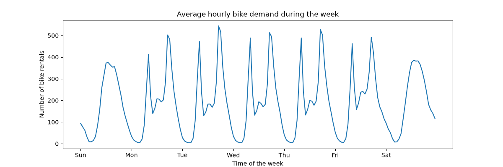
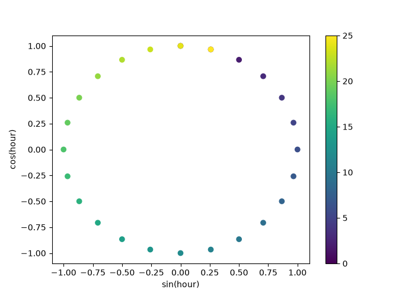
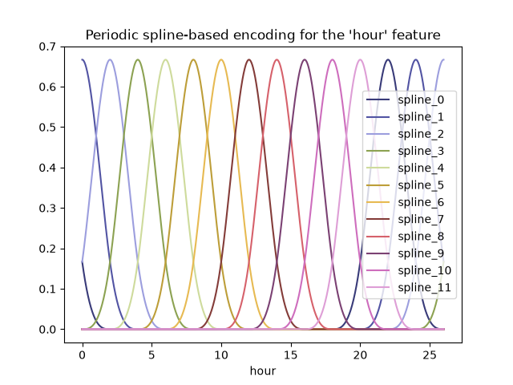
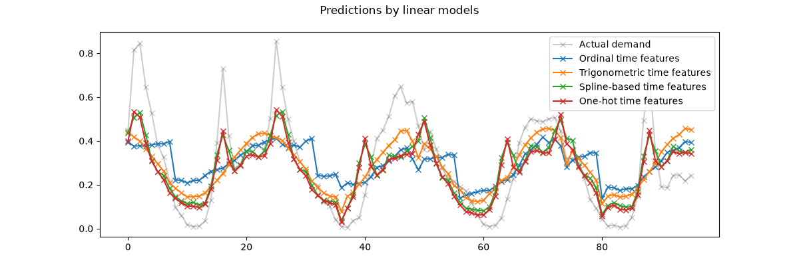

## Una serie también cabe en una tabla

Para estimar **los alquileres de la siguiente hora**:

1. Cada hora de destino se convierte en una fila.
2. El pasado y el calendario forman las variables.
3. Una regresión o un ensamble predice la demanda.
4. Evaluamos en horas posteriores al entrenamiento.

Después cambiaremos la representación de ese pasado para introducir una **RNN**.

::: {.notes}
Inicio, 2 minutos. Recuperar regresión y ensambles de las clases anteriores. Preguntar qué columnas construirían para predecir la siguiente hora. No es necesario introducir una arquitectura nueva para formular el problema como aprendizaje supervisado. En esta clase el caso conductor es demanda de bicicletas. El arco de variables tabulares a recurrencia toma como referencia narrativa el material suministrado [@evolutionPDF], contrastado con los ejemplos oficiales y el capítulo 15 de Géron. No se supone que una RNN supere al modelo tabular.
:::

<!-- 03 -->
## Predecimos con el pasado

$$\widehat y_t=f(y_{t-1},y_{t-2},\ldots,c_t)$$

- **Objetivo $y_t$:** alquileres durante la hora $t$.
- **Origen:** final de la hora $t-1$.
- **Horizonte:** una hora.
- **Calendario $c_t$:** hora y día de destino, ya conocidos.

::: {.notes}
3 minutos. Fijar la notación para toda la clase. y_t solo se observa al terminar la hora t. Las observaciones históricas llegan sin demora en el escenario inicial. c_t representa variables de calendario, no el estado meteorológico observado durante t. Las decisiones sobre origen, horizonte y disponibilidad de datos preceden a elegir el modelo. Un pronóstico no equivale a una predicción retrospectiva con todas las variables de la misma fila disponibles.
:::

<!-- 04 -->
## La demanda sigue ciclos semanales

{width="960px" fig-align="center" alt="Promedio de alquileres por hora de la semana: dos picos diarios entre semana y un pico más amplio los fines de semana"}

Los días laborales presentan picos de desplazamiento distintos al fin de semana.

::: {.ts-source}
Figura oficial de scikit-learn, Bike Sharing Demand, BSD-3-Clause [@sklearnCyclical].
:::

::: {.notes}
4 minutos. Traducir los ejes: Sun es domingo, el eje vertical cuenta alquileres y el horizontal recorre las horas de una semana. La gráfica agrega observaciones de distintas semanas: es una descripción del conjunto, no una secuencia concreta que vaya a pronosticarse. Señalar los picos de mañana y tarde de los días laborales. Si se exploran patrones para decidir variables en un experimento nuevo, usar solo el periodo de entrenamiento.
:::

<!-- 05 -->
## Los patrones conviven con el ruido

| Componente | Ejemplo en demanda |
|:--|:--|
| Tendencia | Un cambio sostenido del nivel de uso |
| Estacionalidad | Repetición diaria o semanal |
| Variación no explicada | Eventos o factores que faltan |

Una misma hora del calendario puede tener demandas distintas.

::: {.ts-source}
Adaptación conceptual del capítulo 15 [@geron2022].
:::

::: {.notes}
3 minutos. Son categorías para razonar sobre una serie, no una descomposición estimada de estos datos. Un cambio de nivel también puede ser abrupto. La estacionalidad repite patrones con un periodo definido. No toda variación residual es ruido irreducible: una variable omitida puede explicar parte de ella. El modelo aprende patrones útiles y la evaluación comprueba si se sostienen en otro periodo.
:::

<!-- 06 -->
## Solo usamos lo que ya conocemos

::: {.ts-table}
| Variable para predecir $y_t$ | ¿Disponible al final de $t-1$? |
|:--|:--|
| Alquileres en $t-1$ | Sí, si ya llegaron los datos |
| Hora y festivo de $t$ | Sí, con calendario conocido |
| Temperatura observada en $t$ | Todavía no |
| Pronóstico del clima para $t$ | Sí, si ya estaba emitido |
:::

La disponibilidad se comprueba en el **origen del pronóstico**.

::: {.notes}
3 minutos. Cerrar el primer bloque, 15 minutos incluida la portada. Las fuentes meteorológicas usadas en un sistema real deben conservar fecha de emisión para reproducir lo que estaba disponible. El ejemplo cíclico oficial incluye variables contemporáneas de clima para estudiar representaciones [@sklearnCyclical]. Esa información no puede trasladarse automáticamente a un pronóstico operativo de una hora. No usar el futuro observado como si fuese un pronóstico ya conocido.
:::

<!-- 07 -->
## Cada fila resume un pasado distinto

Serie didáctica por hora: **40, 55, 70, 90, 80** alquileres.

| Hora objetivo | $y_{t-3}$ | $y_{t-2}$ | $y_{t-1}$ | $y_t$ |
|:--|--:|--:|--:|--:|
| 09:00 | 40 | 55 | 70 | **90** |
| 10:00 | 55 | 70 | 90 | **80** |

Las columnas históricas forman $X$. La última columna es el objetivo.

::: {.notes}
3 minutos. Bloque de variables, 25 minutos. Los datos inventados representan 06:00 a 10:00 de un día ficticio y no son observaciones del dataset. Cada fila usa tres horas anteriores a su destino. En una regresión tabular el orden histórico se representa mediante la identidad de las columnas: lag_1 y lag_3 no son intercambiables. Compartir pasado entre filas cercanas genera dependencia entre muestras y obliga a revisar cómo evaluamos. Idea de tabularización adaptada de [@sklearnLagged].
:::

<!-- 08 -->
## Un rezago exige una rejilla regular

Entrada: `df` con índice temporal y columna `count`.

```python
y = df["count"].sort_index()
assert y.index.is_unique
y = y.asfreq("h")
horas_sin_dato = y[y.isna()].index
```

- `shift(24)` desplaza **24 filas**.
- La rejilla horaria permite identificar horas ausentes.
- Una hora sin registro no significa demanda cero.

::: {.notes}
3 minutos. Para los fragmentos siguientes, tomar un tramo horario continuo sin faltantes. Este código diagnostica los huecos, no los rellena ni selecciona automáticamente el tramo. asfreq inserta NaN si la rejilla encuentra huecos. Antes deben comprobarse zona horaria, precisión de marcas y convención de inicio o fin de hora. No eliminar marcas duplicadas sin investigar su causa. Si se imputan faltantes, la regla debe usar información disponible en el origen y ajustarse dentro del entrenamiento. No interpolar con observaciones futuras. Los rezagos por filas del ejemplo oficial requieren esta precaución al interpretarlos como horas.
:::

<!-- 09 -->
## Los rezagos aportan varias escalas

```python
tab = y.to_frame("objetivo")
for k in [1, 2, 3, 24, 168]:
    tab[f"lag_{k}"] = y.shift(k)
```

| Rezago | Información candidata |
|:--|:--|
| 1, 2, 3 horas | Dinámica reciente |
| 24 horas | Misma hora del día anterior |
| 168 horas | Misma hora de la semana anterior |

::: {.ts-source}
Adaptación a pandas del ejemplo oficial escrito en Polars [@sklearnLagged].
:::

::: {.notes}
3 minutos. El target se alinea con la hora t del índice de tab. Ninguna columna lag contiene y_t. Elegir escalas por conocimiento del problema y validar su utilidad. Las primeras 168 filas no tienen historia semanal completa y se excluirán del ejemplo, no se rellenarán con ceros. La versión oficial incluye también rezagos 25 y 169 para observar el entorno de los ciclos. Aquí se simplifica deliberadamente. Mantener nombres lag_k en el resto de los fragmentos.
:::

<!-- 10 -->
## La media móvil termina en el pasado

$$m_t=\frac{1}{24}\sum_{j=1}^{24}y_{t-j}$$

```python
tab["media_24h"] = y.shift(1).rolling(24).mean()
```

- `shift(1)` deja a $y_t$ fuera de la ventana.
- `rolling(24)` resume las últimas 24 horas observadas.
- Una ventana centrada incluiría observaciones futuras.

::: {.ts-source}
Estadísticas móviles adaptadas de [@sklearnLagged].
:::

::: {.notes}
3 minutos. El valor disponible al final de t-1 incluye desde t-24 hasta t-1. El desplazamiento antes de rolling hace explícita la disponibilidad. Pandas usa una ventana retrospectiva por defecto, pero rolling(24) sin desplazar incluye el valor de la propia fila objetivo. Explicar por qué una agregación aparentemente inocente puede revelar la respuesta. El mínimo de 24 observaciones por defecto también evita medias calculadas con una historia incompleta en este ejemplo.
:::

<!-- 11 -->
## ¿Cuál variable conoce el futuro?

Queremos predecir `y[t]` al final de la hora anterior.

| Opción | Variable |
|:--|:--|
| A | `y.shift(1)` |
| B | `y.rolling(24).mean()` |
| C | `y.index.hour` |

::: {.fragment}
**B incluye `y[t]`**, que todavía no observamos.
:::

::: {.notes}
3 minutos de discusión. Pedir primero una justificación, después revelar la respuesta. A es observable suponiendo llegada inmediata. C es el calendario de la hora de destino. B mezcla la respuesta con las entradas. Extensión oral: si los conteos llegan con dos horas de retraso, ¿sigue siendo A válida? No: hay que cambiar el conjunto de rezagos disponibles. La regla es disponibilidad de información, no una lista universal de funciones prohibidas.
:::

<!-- 12 -->
## El calendario está disponible

```python
tab["hora"] = tab.index.hour
tab["dia_semana"] = tab.index.dayofweek
```

- La hora describe la posición dentro del día.
- El día de semana distingue rutinas semanales.
- Un calendario local añade festivos conocidos.

La hora pico puede depender de que el día sea **laboral**.

::: {.notes}
2 minutos. dayofweek en pandas asigna lunes=0. No confundirlo con la convención del dataset o de la figura oficial, cuya semana comienza el domingo. workingday exige combinar fines de semana y festivos del lugar. En el ejemplo mínimo de código solo añadimos hora y dia_semana. Las columnas son numéricas, pero sus números no implican que la demanda sea lineal en el calendario. El siguiente bloque estudia sus representaciones.
:::

<!-- 13 -->
## La hora ordinal limita al modelo

Con un único término lineal: $\widehat y=b+w\,\text{hora}$.

- Una pendiente no representa dos picos diarios.
- Las horas 23 y 0 quedan lejos numéricamente.
- **One-hot** permite un coeficiente por categoría.

```python
from sklearn.preprocessing import OneHotEncoder
horas = OneHotEncoder(handle_unknown="ignore")
```

::: {.ts-source}
Comparación de representaciones del calendario [@sklearnCyclical].
:::

::: {.notes}
2 minutos. El código solo construye el transformador: se ajusta con las horas de entrenamiento dentro de un pipeline, no sobre todo el dataset. One-hot puede representar picos sin imponer continuidad entre horas vecinas. Sus categorías pueden fijarse de antemano por calendario para contemplar las 24 horas. Una regresión lineal sí puede modelar relaciones no lineales con la hora si transformamos las entradas. El problema de pendiente corresponde a usar la hora numérica cruda en ese modelo, no a todos los algoritmos clásicos.
:::

<!-- 14 -->
## Seno y coseno cierran el ciclo

:::: {.columns}
::: {.column width="46%"}
$$s_t=\sin(2\pi\,\text{hora}_t/24)$$
$$q_t=\cos(2\pi\,\text{hora}_t/24)$$

Las horas 23 y 0 quedan próximas.

Un solo par puede resultar rígido para varios picos.
:::
::: {.column width="54%"}
{height="340px" alt="Horas representadas en un círculo con las coordenadas seno y coseno, sin discontinuidad en medianoche"}
:::
::::

::: {.ts-source}
Figura oficial de scikit-learn, BSD-3-Clause [@sklearnCyclical].
:::

::: {.notes}
3 minutos. s_t y q_t son las coordenadas seno y coseno de la hora objetivo. Señalar que la hora se representa por dos coordenadas juntas. Usar solo el seno confunde algunas horas. Una combinación lineal de un único par sinusoidal ofrece una forma suave y simple, no cualquier curva diaria. Añadir armónicos o interacciones amplía la familia, pero no se desarrollan aquí. La figura incluye horas de extrapolación 24 y 25 que vuelven al inicio del ciclo.
:::

<!-- 15 -->
## Los splines permiten picos locales

:::: {.columns}
::: {.column width="58%"}
{height="335px" alt="Doce funciones base de spline periódico localizadas en diferentes horas, que se unen al pasar por medianoche"}
:::
::: {.column width="42%"}
Cada base cubre parte del día.

La regresión aprende su peso.

La opción **periódica** une los extremos.
:::
::::

::: {.ts-source}
`SplineTransformer(extrapolation="periodic")`. Figura oficial, BSD-3-Clause [@sklearnCyclical].
:::

::: {.notes}
3 minutos. Cerrar variables, 25 minutos. Cada línea es una variable transformada, no una predicción ni una subserie de alquileres. Una combinación de estas bases permite respuestas locales más flexibles que un único par seno/coseno. El número de nudos controla flexibilidad y se selecciona con validación temporal. Para fijar un periodo exacto de 24 horas se deben especificar nudos con extremos 0 y 24, en lugar de deducir extremos 0 y 23 de los datos. Ejemplo de configuración: SplineTransformer(knots=np.linspace(0, 24, 13).reshape(-1, 1), extrapolation="periodic", include_bias=False). Las interacciones con tipo de día siguen siendo relevantes.
:::

<!-- 16 -->
## Las bases fijan la comparación

| Referencia | Pronóstico de $y_t$ |
|:--|:--|
| Persistencia | $\widehat y_t=y_{t-1}$ |
| Estacional diaria | $\widehat y_t=y_{t-24}$ |
| Estacional semanal | $\widehat y_t=y_{t-168}$ |

¿El modelo mejora estas referencias en **las mismas horas**?

::: {.ts-source}
Referencias ingenuas y estacionales [@geron2022].
:::

::: {.notes}
3 minutos. Iniciar ML y evaluación, 30 minutos. Estas referencias no requieren entrenar parámetros, pero sí historia disponible. Elegir la referencia estacional relevante con validación y reportar varias si aporta contexto. Compararlas únicamente donde todas tienen rezagos y etiquetas válidos. Un modelo que no mejora una base útil puede no justificar su complejidad. SARIMA es otra referencia tratada en el capítulo, pero no se desarrolla para mantener el foco en modelos tabulares y recurrencia.
:::

<!-- 17 -->
## Ridge combina señales regularizadas

$$\widehat y_t=b+\sum_j w_j x_{t,j}$$

```python
from sklearn.pipeline import make_pipeline
from sklearn.preprocessing import StandardScaler
from sklearn.linear_model import Ridge
lineal = make_pipeline(
    StandardScaler(), Ridge(alpha=1.0)
)
```

El escalado y los pesos se ajustan **solo con entrenamiento**.

::: {.notes}
3 minutos. El pipeline recibe columnas numéricas: rezagos, media y calendario del ejemplo mínimo. alpha=1 es ilustrativo, no una selección optimizada. Elegir alpha mediante cortes temporales. Al añadir one-hot o splines, incluir sus transformaciones dentro del mismo pipeline con ColumnTransformer. La regularización ayuda cuando los rezagos están correlacionados. No convierte automáticamente la hora ordinal en una variable cíclica. El modelo lineal puede representar efectos no lineales si cambia la representación de x.
:::

<!-- 18 -->
## Los árboles aprenden interacciones

```python
from sklearn.ensemble import HistGradientBoostingRegressor
arboles = HistGradientBoostingRegressor(
    max_iter=100, max_leaf_nodes=15,
    early_stopping=False, random_state=42
)
```

- Los cortes pueden combinar hora y día de semana.
- Los árboles no necesitan estandarización.
- La complejidad se elige con validación temporal.

::: {.ts-source}
Gradient boosting con rezagos [@sklearnLagged].
:::

::: {.notes}
3 minutos. Una rama puede separar días laborales antes de distinguir horas. Estas interacciones se aprenden a partir de las variables disponibles. El algoritmo sigue necesitando rezagos o resúmenes para acceder al pasado. Desactivamos early stopping interno para no introducir aquí una partición aleatoria de validación. En un desarrollo completo puede usarse una validación cronológica explícita para decidir el número de iteraciones. Los hiperparámetros mostrados solo ilustran la interfaz. No se ha entrenado ni medido este modelo para la presentación.
:::

<!-- 19 -->
## La codificación cambia el pronóstico

{width="960px" alt="Predicciones publicadas: las codificaciones ordinal, trigonométrica, por splines y one-hot producen diferentes curvas frente a la demanda real"}

Splines y one-hot siguen mejor algunos picos, pero aún faltan interacciones.

::: {.ts-source}
Resultado publicado, demanda normalizada. Figura oficial, BSD-3-Clause [@sklearnCyclical].
:::

::: {.notes}
4 minutos. Explicar leyenda: gris es demanda observada, azul codificación ordinal, naranja trigonométrica, verde splines y rojo one-hot. Eje horizontal: observaciones de las últimas 96 horas de un corte de prueba del ejemplo oficial. Eje vertical: demanda normalizada respecto al máximo en ese ejemplo, no alquileres crudos. Es una comparación de codificaciones en regresiones lineales, no de RNN contra boosting. Los efectos aditivos no capturan por completo cómo cambia la forma diaria según el tipo de día. El ejemplo incluye clima contemporáneo: ilustra ingeniería de variables, no por sí solo nuestro protocolo operativo sin clima futuro observado. Estos son resultados externos, no experimentos ejecutados aquí.
:::

<!-- 20 -->
## El entrenamiento precede a la prueba

| Periodo | Uso |
|:--|:--|
| Pasado inicial | Ajustar transformaciones y modelo |
| Periodo siguiente | Seleccionar variables e hiperparámetros |
| Pasado más reciente | Prueba final reservada |

- El reparto aleatorio puede mezclar pasado y futuro.
- La dependencia temporal cambia cómo evaluamos.

::: {.ts-source}
Evaluación de pronósticos [@sklearnLagged; @geron2022].
:::

::: {.notes}
3 minutos. Las filas de X pueden estar tabularizadas y seguir siendo dependientes. No todos los algoritmos de regresión requieren observaciones independientes para calcular una predicción, pero las garantías estadísticas y la evaluación i.i.d. no se trasladan automáticamente. Preservar un bloque final que no interviene en elegir variables, escalas ni hiperparámetros. Al cerrar el diseño puede reajustarse con entrenamiento y validación, sin usar etiquetas futuras de la prueba para entrenar. No confundir historia observada disponible para construir una entrada con usar la prueba para optimizar el modelo.
:::

<!-- 21 -->
## Cada corte simula un nuevo origen

```python
from sklearn.model_selection import TimeSeriesSplit
datos = tab.dropna()
X = datos.drop(columns="objetivo")
y_obj = datos["objetivo"]
cv = TimeSeriesSplit(n_splits=3, test_size=168, gap=0)
for idx_tr, idx_va in cv.split(X):
    lineal.fit(X.iloc[idx_tr], y_obj.iloc[idx_tr])
    pred = lineal.predict(X.iloc[idx_va])
```

Cada bloque de validación contiene una semana horaria.

::: {.notes}
4 minutos. Requiere un tramo horario continuo, suficientemente largo, y un bloque final de prueba apartado antes de construir esta tabla de desarrollo. En este supuesto dropna solo elimina filas iniciales sin historia, y no huecos interiores. Los cortes son crecientes: un bloque de validación anterior puede ser entrenamiento en un corte posterior, simulando el paso del tiempo. El modelo se reajusta en cada corte, mientras que dentro de cada semana permanece fijo. El código muestra el mecanismo, no calcula métricas ni busca hiperparámetros. gap=0 corresponde al escenario de un paso con etiquetas disponibles inmediatamente. Se ampliaría si hay demora de publicación o etiquetas con horizontes que se solapan. El 48 del ejemplo oficial es una elección de ese experimento, no una constante universal.
:::

<!-- 22 -->
## El origen fija el pasado disponible

::: {.ts-table}
| Protocolo | Para pronosticar la segunda hora |
|:--|:--|
| Un paso, origen actualizado | Ya observamos la primera hora |
| Varias horas, origen fijo | La primera hora sigue siendo futura |
:::

- Un rezago observado en prueba sirve en el primer caso.
- En origen fijo exige un pronóstico o un modelo directo.
- El `gap` responde al horizonte y a demoras de las etiquetas.

::: {.notes}
3 minutos. Los rezagos calculados en todo el bloque de validación son coherentes para simular pronósticos de un paso sucesivos, porque antes de cada origen llegan observaciones nuevas. No implican reajustar el modelo en cada hora. Sí revelarían futuro si se interpretaran como un pronóstico simultáneo de toda la semana emitido en el primer origen. Un hueco entre entrenamiento y validación no convierte por sí solo un protocolo de un paso en uno de varios pasos. Para un horizonte directo H, comprobar que las etiquetas usadas al entrenar ya se conocen en cada origen, y purgar las que no. Son dos decisiones distintas: separación de muestras y disponibilidad de entradas.
:::

<!-- 23 -->
## MAE mide errores en alquileres

$$\mathrm{MAE}=\frac{1}{n}\sum_{i=1}^n|y_i-\widehat y_i|$$

$$\mathrm{RMSE}=\sqrt{\frac{1}{n}\sum_{i=1}^n(y_i-\widehat y_i)^2}$$

- Ambas se expresan en alquileres por hora.
- RMSE da más peso a errores grandes.
- MAPE divide por la demanda y se complica cerca de cero.

::: {.notes}
3 minutos. i recorre las horas evaluadas y no las iteraciones del entrenamiento. Si se normaliza el objetivo, invertir la transformación antes de reportar errores en alquileres por hora. Para MAPE un error de cinco alquileres tiene un peso muy distinto cuando el objetivo es uno o quinientos. En cero el porcentaje carece de definición matemática, y los ajustes numéricos de una librería no lo vuelven interpretable. Reportar variación entre periodos y revisar horas pico si importan para la decisión. MAE no informa por sí solo de si todos los errores corresponden al mismo momento del día.
:::

<!-- 24 -->
## La prueba compara tareas iguales

- Mismos orígenes, horizonte y horas evaluadas.
- Misma información disponible al pronosticar.
- Transformaciones aprendidas dentro de cada corte.
- Selección del modelo antes de abrir la prueba final.
- Errores comparados con persistencia y estacionalidad.

Una arquitectura más compleja debe **demostrar su utilidad**.

::: {.notes}
4 minutos. Cerrar ML y evaluación, 30 minutos. El caso tabular puede incluir calendario y la primera RNN será univariada para enseñar el mecanismo. No sería una comparación controlada de arquitecturas si luego se atribuyera su diferencia de error solo a la recurrencia. Para ese experimento usar el mismo conjunto de información: retirar calendario de la comparación inicial o proporcionarlo también a la red. No hay ranking ni métricas nuevas de modelos en esta presentación. Recordar que la calidad de los datos y el protocolo pueden cambiar más la conclusión que la elección de arquitectura.
:::

<!-- 25 -->
## La ventana también es una secuencia

Para el objetivo de las 09:00, usamos **40, 55, 70**.

| Representación | Una muestra |
|:--|:--|
| Tabla, columnas por rezago | `[40, 55, 70]` |
| Secuencia, pasos con una variable | `[[40], [55], [70]]` |

Mismo pasado. En la secuencia, **cada fila interna es una hora**.

::: {.notes}
3 minutos. Iniciar RNN, 40 minutos. El orden va de la observación más antigua a la más reciente: lag_3, lag_2, lag_1. Esa convención se conserva al formar tensores. La fila tabular podría ordenarse al revés si las columnas están bien identificadas, pero el orden secuencial importa para la recurrencia que enseñaremos. No se añadieron datos ni desapareció la necesidad de elegir una ventana. La RNN aprende una representación del pasado observado dentro de esa ventana [@geron2022].
:::

<!-- 26 -->
## ¿Qué forma recibe una RNN?

Dos ventanas, tres horas por ventana, una variable por hora:

```python
import numpy as np
ventanas = np.array([[[40], [55], [70]],
                     [[55], [70], [90]]])
```

¿Cuál es la forma de `ventanas`?

::: {.fragment}
**`(2, 3, 1)` = (muestras, pasos temporales, variables)**.
:::

::: {.notes}
4 minutos. Dar un minuto para responder y pedir que señalen cada eje antes de mostrar la solución. Los objetivos de estas dos ventanas son 90 y 80. No confundir tres pasos con tres variables simultáneas. Si en cada hora se observaran demanda y temperatura histórica, el último eje tendría dos variables. Una muestra de entrada para inferencia conserva el eje de lote, de modo que su forma sería (1, 3, 1). Los números son el ejemplo didáctico anterior, no datos reales.
:::

<!-- 27 -->
## El lote reúne ventanas consecutivas

```python
valores = y.to_numpy(dtype="float32")[:, None]
T = 24
X_seq = np.stack([
    valores[t-T:t] for t in range(T, len(valores))
])
y_seq = valores[T:, 0]
```

`X_seq`: **(N − 24, 24, 1)**. `y_seq`: **(N − 24,)**.

Cada ventana termina una hora antes de su objetivo.

::: {.notes}
4 minutos. np fue importado en el fragmento anterior. N es la longitud del tramo horario continuo y debe superar T. Para el primer objetivo, en posición 24, el slice 0:24 contiene observaciones 0 a 23. Estos arrays aún no están escalados ni partidos. Separar por fecha de la etiqueta y reservar prueba final. Una ventana de validación puede usar historia anterior al corte siempre que esa historia estuviera disponible en su origen. Ajustar escalado con observaciones del entrenamiento y aplicarlo sin reajustar a validación y prueba. No mezclar ventanas cuyo objetivo pertenece al futuro del corte de entrenamiento. En producción puede generarse cada ventana sin materializar todas a la vez. Géron ofrece utilidades de Keras para este proceso [@geron2022].
:::

<!-- 28 -->
## El estado resume lo observado

$$h_j=\tanh(W_x x_j+W_h h_{j-1}+b_h)$$

$$\widehat y_t=w_o^\top h_T+b_o$$

- $x_j$: observación del paso $j$ dentro de la ventana.
- $h_j$: estado oculto después de leer ese paso.
- Leemos del pasado al presente, con $h_0=0$.

::: {.ts-source}
Celda recurrente y lectura final, adaptadas de [@geron2022].
:::

::: {.notes}
4 minutos. j es un índice local de 1 a T, diferente de la hora de destino t. Con una variable, x_j corresponde a y_{t-T+j-1}. Por ello x_T=y_{t-1} y la salida final predice y_t. Usamos vectores columna: W_x tiene forma H por F y W_h forma H por H. La celda actualiza un resumen aprendido, no guarda una copia exacta de toda la historia. La proyección de lectura final es una capa densa con salida lineal. La ecuación matemática es equivalente a la de Keras, aunque la librería almacena matrices con otra convención de orientación.
:::

<!-- 29 -->
## Los pesos se comparten en el tiempo

| Paso | Entrada | Estado calculado | Parámetros |
|:--|:--|:--|:--|
| 1 | $x_1$ | $h_1=f(x_1,0)$ | $W_x,W_h,b_h$ |
| 2 | $x_2$ | $h_2=f(x_2,h_1)$ | Los mismos |
| 3 | $x_3$ | $h_3=f(x_3,h_2)$ | Los mismos |

Aumentar los pasos **no añade una matriz nueva por hora**.

::: {.notes}
3 minutos. Este es el despliegue temporal de una sola celda, no tres capas con parámetros diferentes. El estado cambia en cada paso, los parámetros permanecen fijos durante la pasada hacia adelante. Para F=1 y H=16, la celda tiene 16+256+16=288 parámetros y la lectura escalar añade 17. Con H y F fijos, esos 305 parámetros no aumentan al pasar de 24 a 48 pasos. Sí aumentan el trabajo y la memoria requeridos durante entrenamiento. No equiparar pesos compartidos con bajo costo garantizado.
:::

<!-- 30 -->
## El estado cambia con cada entrada

Ejemplo escalar: $h_j=\tanh(0.5x_j+0.5h_{j-1})$, $h_0=0$.

| Paso | $x_j$ | $h_{j-1}$ | $h_j$ aproximado |
|:--|--:|--:|--:|
| 1 | 0 | 0 | 0 |
| 2 | 1 | 0 | 0.462 |
| 3 | 0 | 0.462 | 0.227 |

En el tercer paso, la entrada es cero y **persiste parte del pasado**.

::: {.notes}
4 minutos. Ejemplo propio con valores normalizados, no conteos reales ni resultado de entrenamiento. Calcular primero tanh(0.5), aproximadamente 0.462117, y luego tanh(0.231059), aproximadamente 0.227032. Los dos pesos se fijaron a 0.5 y el sesgo a cero para enseñar la operación. Si la lectura final tuviera w_o=1 y b_o=0, la predicción normalizada sería 0.227. El decaimiento que se ve aquí también ilustra que preservar una señal no significa conservarla indefinidamente. No interpretar h como una probabilidad.
:::

<!-- 31 -->
## Una salida resume toda la ventana

```python
import tensorflow as tf
model = tf.keras.Sequential([
    tf.keras.layers.Input(shape=(24, 1)),
    tf.keras.layers.SimpleRNN(16, activation="tanh",
                             stateful=False),
    tf.keras.layers.Dense(1)
])
```

`SimpleRNN` entrega el estado final. `Dense(1)` predice $y_t$.

::: {.ts-source}
Interfaz oficial de `SimpleRNN` [@kerasSimpleRNN].
:::

::: {.notes}
3 minutos. La entrada no incluye la dimensión de lote en Input. Cada lote tiene forma (B,24,1). La salida de SimpleRNN tiene forma (B,16) porque return_sequences=False por defecto. Dense entrega (B,1). Las 16 unidades son componentes de un estado vectorial, no 16 horas. Este primer modelo usa solo demanda histórica. El calendario conocido de la hora objetivo podría combinarse con el estado final en una extensión, pero no se implementa en esta introducción. La salida lineal no garantiza conteos no negativos. Si esa restricción es importante, debe incorporarse al diseño y validarse con una pérdida apropiada.
:::

<!-- 32 -->
## Cada ventana reinicia el estado

| Muestra | Entrada | Estado al comenzar |
|:--|:--|:--|
| Objetivo $y_t$ | $y_{t-24},\ldots,y_{t-1}$ | $h_0=0$ |
| Objetivo $y_{t+1}$ | $y_{t-23},\ldots,y_t$ | $h_0=0$ |

- Con `stateful=False`, el estado no pasa al siguiente lote.
- La memoria se reconstruye dentro de cada ventana.

::: {.ts-source}
Semántica del estado recurrente [@kerasSimpleRNN].
:::

::: {.notes}
2 minutos. La segunda muestra solo se consulta cuando y_t ya fue observado. Que haya muestras solapadas no significa que la librería traspase automáticamente h_T de una a otra. Keras también permite initial_state explícito, pero aquí no se proporciona y el estado inicial es cero para cada muestra. Entrenar de forma stateful requiere otra gestión de orden y reinicios, fuera del alcance. Reiniciar evita arrastrar estado entre periodos o series que no deberían conectarse. Aun con estados independientes, la partición temporal de las etiquetas sigue siendo necesaria.
:::

<!-- 33 -->
## BPTT reúne gradientes de cada paso

1. La pasada hacia adelante calcula $h_1,\ldots,h_T$.
2. La pérdida compara $\widehat y_t$ con $y_t$.
3. El gradiente recorre las operaciones de la ventana.
4. Se suman las contribuciones a los pesos compartidos.
5. El optimizador realiza una actualización por lote.

**Backpropagation through time** usa la misma regla de la cadena.

::: {.ts-source}
Entrenamiento de redes recurrentes [@geron2022].
:::

::: {.notes}
3 minutos. Dibujar oralmente la ruta de dependencia desde la lectura final hasta h_T, luego h_{T-1}, etc. No se exige una etiqueta por paso: la pérdida final produce gradientes para operaciones anteriores. Los pesos compartidos reciben contribuciones de cada uso en la ventana. Primero se acumula el gradiente de la pérdida del lote, después se actualizan los pesos, no se actualiza un peso tras cada paso durante esa misma pasada. Las ventanas limitan la historia usada para entrenar este modelo. No hace falta derivar todos los jacobianos en esta clase.
:::

<!-- 34 -->
## La RNN aprende con ventanas

Entrada: ventanas separadas por fecha del objetivo y escaladas con entrenamiento.

```python
model.compile(optimizer="adam", loss="mse", metrics=["mae"])
model.fit(
    X_train_seq, y_train_seq,
    validation_data=(X_val_seq, y_val_seq),
    epochs=30, batch_size=32, shuffle=True
)
```

El orden **dentro de cada ventana** se conserva.

::: {.notes}
3 minutos. Los cuatro arrays son entradas necesarias de este fragmento, preparados mediante el corte por fecha de objetivo explicado antes. No se definen aquí para una fecha concreta porque no se entrega un notebook ni se descarga el dataset. El escalado de la serie se estima solo con entrenamiento y se aplica a las etiquetas de ambos periodos con los mismos parámetros. shuffle=True mezcla muestras de entrenamiento dentro de una época: puede usarse con estas ventanas de estado reiniciado y no altera los pasos internos. No equivale a repartir aleatoriamente entrenamiento y validación. epochs=30 solo ilustra un presupuesto, no una recomendación ajustada. Para escoger duración se puede usar parada temprana con validación cronológica y restauración del mejor estado. No se muestran resultados de entrenamiento.
:::

<!-- 35 -->
## La memoria útil puede ser corta

- Repetir transformaciones puede diluir información.
- Los gradientes pueden desaparecer o crecer demasiado.
- Ventanas largas elevan el costo del entrenamiento.
- El estado resume el pasado con capacidad limitada.

LSTM y GRU amplían las opciones para una clase posterior.

::: {.ts-source}
Limitaciones de las RNN simples [@geron2022].
:::

::: {.notes}
3 minutos. No fijar un número universal de pasos que una RNN recuerda. Depende del problema, la parametrización y el entrenamiento. El recorte de gradientes ayuda cuando explotan, pero no recupera por sí mismo gradientes que se desvanecen. Normalización, elección de ventana y arquitecturas con compuertas son opciones que se estudian después. No desarrollar compuertas, secuencia a secuencia, Conv1D ni WaveNet. La recurrencia no elimina la necesidad de regularidad temporal, variables conocidas, escalado ni selección del contexto.
:::

<!-- 36 -->
## La RNN también necesita validación

- Comparar con las bases y los modelos tabulares.
- Ofrecer la misma información a todos los modelos.
- Deshacer el escalado antes de medir alquileres.
- Revisar error en horas pico y periodos posteriores.
- Medir costo de entrenamiento y de inferencia.

Una RNN pequeña puede ejecutarse en **CPU**.

::: {.notes}
4 minutos. Cerrar recurrencia, 40 minutos. Una GPU puede acelerar ciertos entrenamientos, pero no es requisito conceptual ni necesario para toda RNN. Tampoco se promete ventaja en precisión. Nuestra red inicial univariada y el modelo con calendario son demostraciones de formulación, no una competencia controlada. Para comparar arquitecturas, usar una versión tabular con solo la misma historia o extender la red con el mismo calendario disponible. Evaluar ambos con los mismos cortes y reportar variabilidad. Revisar el régimen operativo de un paso definido al inicio antes de interpretar cualquier métrica.
:::

<!-- 37 -->
## Los datos y el costo guían la elección

::: {.ts-table}
| Criterio | Modelo tabular | RNN básica |
|:--|:--|:--|
| Representación | Rezagos y resúmenes | Secuencia y estado aprendido |
| Contexto observado | Variables construidas | Ventana de entrada elegida |
| Interacciones | Explícitas o aprendidas | Transformaciones recurrentes |
| Costo | Medir según el modelo | Crece con pasos y estado |
| Evidencia necesaria | Validación temporal | La misma validación temporal |
:::

La elección depende del resultado y del uso previsto.

::: {.notes}
3 minutos. No imponer umbrales como «a partir de 10.000 muestras usar RNN». Contar datos no basta: importa la diversidad de series, su dependencia, la estabilidad del proceso y la señal del problema. Los ensambles tabulares pueden aprender interacciones sin construir cada cruce a mano. Una RNN de ventanas también depende de un contexto elegido. La tabla sintetiza las diferencias sin convertirlas en una regla de superioridad. La memoria aprendida es una representación, no acceso al futuro ni a observaciones ausentes.
:::

<!-- 38 -->
## El escenario cambia la decisión

**Caso A:** seis meses horarios de una ciudad, pronóstico de una hora y CPU.

**Caso B:** muchas ciudades, historias extensas y dinámica compartida.

Para cada caso:

1. Propón una base y un modelo candidato.
2. Define qué datos estarán disponibles al pronosticar.
3. Explica qué resultado justificaría usar una RNN.

::: {.notes}
4 minutos. Actividad en parejas. A: persistencia y base estacional, después Ridge o boosting con variables temporales como punto de partida razonable. CPU no prohíbe evaluar una RNN pequeña. B: comparar también una RNN compartida entre series si hay razones para aprender patrones comunes. Mantener identidad de ciudad, cortes por tiempo y objetivos operativos bien definidos. No hay respuesta obligatoria por volumen de datos: exigir evidencia fuera de muestra y un costo aceptable. Si se evalúa generalización a nuevas ciudades, ese es otro protocolo y debe aislar ciudades además de separar periodos.
:::

<!-- 39 -->
## Ticket de salida

1. ¿Por qué desplazar una media móvil antes de usarla?
2. ¿Qué representa cada eje de **(32, 24, 1)**?
3. ¿Qué comparten los pasos de una misma RNN?
4. ¿Cómo demostrarías que mejora una base estacional?

::: {.notes}
3 minutos. Respuestas: 1) excluir y_t y mantener disponibilidad de información en el origen, bajo el escenario de esta clase. 2) 32 muestras, 24 pasos, una variable por paso. 3) los parámetros de la celda, mientras el estado cambia en cada paso. 4) mismos periodos, horizonte, información, unidades y protocolo de validación, con selección separada de la prueba final. Recordar las dos decisiones que atravesaron toda la clase: qué pasado entregamos al modelo y cómo simulamos su uso futuro.
:::

<!-- 40 -->
## Referencias

::: {#refs}
:::

::: {.notes}
Para ampliar: capítulo 15 de Géron y los dos ejemplos oficiales de scikit-learn. Las figuras reproducen los resultados publicados de esos ejemplos. Los rótulos se mantienen en inglés y se explican durante la clase.

Aviso de licencia de scikit-learn para las figuras redistribuidas, BSD 3-Clause License:

Copyright (c) 2007-2026 The scikit-learn developers. All rights reserved.

Redistribution and use in source and binary forms, with or without modification, are permitted provided that the following conditions are met:

1. Redistributions of source code must retain the above copyright notice, this list of conditions and the following disclaimer.
2. Redistributions in binary form must reproduce the above copyright notice, this list of conditions and the following disclaimer in the documentation and/or other materials provided with the distribution.
3. Neither the name of the copyright holder nor the names of its contributors may be used to endorse or promote products derived from this software without specific prior written permission.

THIS SOFTWARE IS PROVIDED BY THE COPYRIGHT HOLDERS AND CONTRIBUTORS "AS IS" AND ANY EXPRESS OR IMPLIED WARRANTIES, INCLUDING, BUT NOT LIMITED TO, THE IMPLIED WARRANTIES OF MERCHANTABILITY AND FITNESS FOR A PARTICULAR PURPOSE ARE DISCLAIMED. IN NO EVENT SHALL THE COPYRIGHT HOLDER OR CONTRIBUTORS BE LIABLE FOR ANY DIRECT, INDIRECT, INCIDENTAL, SPECIAL, EXEMPLARY, OR CONSEQUENTIAL DAMAGES (INCLUDING, BUT NOT LIMITED TO, PROCUREMENT OF SUBSTITUTE GOODS OR SERVICES; LOSS OF USE, DATA, OR PROFITS; OR BUSINESS INTERRUPTION) HOWEVER CAUSED AND ON ANY THEORY OF LIABILITY, WHETHER IN CONTRACT, STRICT LIABILITY, OR TORT (INCLUDING NEGLIGENCE OR OTHERWISE) ARISING IN ANY WAY OUT OF THE USE OF THIS SOFTWARE, EVEN IF ADVISED OF THE POSSIBILITY OF SUCH DAMAGE.
:::
